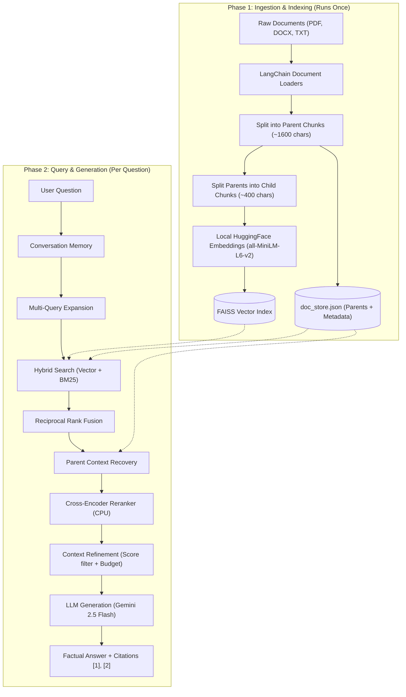

# 📚 Advanced RAG Assistant

[](https://www.python.org/downloads/)
[](https://streamlit.io)
[](https://www.langchain.com)
[](https://ai.google.dev/)
[](https://groq.com/)
[](https://github.com/facebookresearch/faiss)
[](https://opensource.org/licenses/MIT)

An end-to-end, production-grade **Advanced RAG (Retrieval-Augmented Generation)** application built with **Python, LangChain, Google Gemini, FAISS, BM25, Cross-Encoder Rerankers, and Streamlit**.

Upload your documents (PDF, DOCX, TXT), index them with intelligent Parent-Child chunking, and query them through a conversational assistant with **transparent source citations** and an interactive **Retrieval Debug Panel**.

> [!TIP]
> **100% Free to Run:** This project is pre-configured out-of-the-box to use **Google Gemini 2.5 Flash** (Free Tier via Google AI Studio) and **Local HuggingFace embeddings** (`sentence-transformers/all-MiniLM-L6-v2`) on CPU. No credit card or paid API required!

---

## 📑 Table of Contents

- [The Problem: Why Naive RAG Fails](#-the-problem-why-naive-rag-fails)
- [The Solution: 5 Advanced RAG Techniques](#-the-solution-5-advanced-rag-techniques)
- [System Architecture](#-system-architecture)
- [Key Features](#-key-features)
- [Knowledge Base & TechNova Dataset](#-knowledge-base--technova-dataset)
- [Project Structure](#-project-structure)
- [Getting Started](#-getting-started)
  - [Prerequisites](#prerequisites)
  - [Installation](#installation)
  - [Environment Configuration](#environment-configuration)
  - [Building the Vector Index](#building-the-vector-index)
  - [Running the App](#running-the-app)
- [Deploying to Streamlit Community Cloud](#-deploying-to-streamlit-community-cloud)
- [Retrieval Debug Mode Deep Dive](#-retrieval-debug-mode-deep-dive)
- [Evaluation & Testing](#-evaluation--testing)
- [License](#-license)

---

## 🚨 The Problem: Why Naive RAG Fails

Standard ("Naive") RAG follows three simplistic steps:
1. Break documents into arbitrary chunks.
2. Embed chunks into a vector database.
3. Perform a nearest-neighbor vector search and pass the top chunks to an LLM.

In real-world applications, Naive RAG breaks in predictable ways:
* **The Synonym Miss:** The user asks about *"time off"*, but the policy says *"annual leave"*. Pure vector search can drift and miss the chunk.
* **Exact Code Failure:** Searches for alphanumeric identifiers like *"SOC 2 Type II"*, *"ISO-27001"*, or *"TN-SUP-2024"* perform poorly in dense semantic vector spaces.
* **The Chunk Size Dilemma:** Small chunks embed sharply for vector matching, but lack the context the LLM needs to answer. Large chunks provide rich context, but blur distinct semantic topics, degrading search accuracy.
* **False Relevance:** Pure vector distance only measures similarity, not whether a chunk actually *answers* the question.
* **Context Hallucination:** Irrelevant chunks passed into the prompt confuse the LLM, leading to hallucinations or irrelevant answers.

---

## 💡 The Solution: 5 Advanced RAG Techniques

This project systematically overcomes each failure mode using five industry-standard techniques:

```
User Question
    │
    ▼
┌────────────────────────────────────────────────────────┐
│ 1. Multi-Query Generation (with Conversation History)  │  → Rewrites query from multiple perspectives
└──────────────────────────┬─────────────────────────────┘
                           │
    ▼──────────────────────┴──────────────────────▼
┌──────────────────────────────┐  ┌──────────────────────────────┐
│ Dense Vector Search (FAISS)  │  │ Sparse Keyword Search (BM25) │  → 2. Hybrid Search
└──────────────┬───────────────┘  └──────────────┬───────────────┘
               └───────────────┬─────────────────┘
                               ▼
┌────────────────────────────────────────────────────────┐
│ Reciprocal Rank Fusion (RRF) Candidate Merging         │  → Combines semantic + exact keyword matches
└──────────────────────────┬─────────────────────────────┘
                           │
                           ▼
┌────────────────────────────────────────────────────────┐
│ 3. Parent Context Recovery                             │  → Swaps matched child chunks for full parent context
└──────────────────────────┬─────────────────────────────┘
                           │
                           ▼
┌────────────────────────────────────────────────────────┐
│ 4. Cross-Encoder Reranking (ms-marco-MiniLM-L-6-v2)    │  → Scores (Query + Passage) joint interaction
└──────────────────────────┬─────────────────────────────┘
                           │
                           ▼
┌────────────────────────────────────────────────────────┐
│ 5. Context Refinement & Token Budget Management        │  → Drops negative scores, enforces context limit
└──────────────────────────┬─────────────────────────────┘
                           │
                           ▼
┌────────────────────────────────────────────────────────┐
│ LLM Generation (Gemini 2.5 Flash / Groq / OpenAI)      │  → Strict factual answer with citations [1], [2]
└────────────────────────────────────────────────────────┘
```

### 1. Multi-Query Expansion (`src/retrieval.py`)
Users rarely phrase questions the same way documents are written. The pipeline uses the LLM to rewrite the user's prompt into 3 distinct search variants (synonyms, technical terms, plain English). It incorporates conversation history so follow-up questions like *"Does it apply to enterprise users?"* are rewritten into explicit, standalone search queries.

### 2. Hybrid Retrieval with RRF (`src/retrieval.py`)
Combines:
* **Dense Vector Search (FAISS)**: Captures conceptual semantic meaning.
* **Sparse Keyword Search (BM25)**: Guarantees exact matches for policy codes, numbers, and names.
Results are fused using **Reciprocal Rank Fusion (RRF)**:
$$\text{RRF Score}(d) = \sum_{m \in M} \frac{1}{60 + \text{rank}_m(d)}$$
This produces a robust candidate list without needing cross-algorithm score calibration.

### 3. Parent-Child Chunking (`src/chunking.py`)
Solves the chunk size dilemma:
* Documents are first split into large **Parent Chunks** (~1600 characters) to preserve narrative flow and context.
* Each parent is subdivided into small **Child Chunks** (~400 characters).
* **Only child chunks are indexed and searched** in the vector space, keeping embedding vectors sharp and precise.
* When a child matches, its **parent chunk is fetched and injected into the prompt**, ensuring the LLM receives complete context. Duplicate parents are automatically deduplicated.

### 4. Cross-Encoder Reranking (`src/reranking.py`)
Vector retrieval compares vectors produced independently ($f(\text{query})$ vs $f(\text{doc})$). A Cross-Encoder model (`cross-encoder/ms-marco-MiniLM-L-6-v2`) processes the query and passage **jointly** through full cross-attention layers.
* Runs locally on your CPU (zero API cost, fast ~0.08s inference).
* Reorders the top 10 candidates by actual answering relevance.

### 5. Context Refinement & Citation Tracking (`src/refinement.py`)
* **Noise Filter**: Drops any passage with a reranker score below `MIN_RERANK_SCORE` (default `-4.0`).
* **Context Budget**: Enforces a strict character/token budget (default `8,000` chars) so only the highest-scoring context reaches the LLM.
* **Verified Citations**: Automatically tracks source files and section names, requiring the LLM to cite passages like `[1]` and `[2]`.

---

## 🏛 System Architecture



---

## ✨ Key Features

* 💬 **Conversational Chat Interface:** Streamlit UI with multi-turn chat memory and session state management.
* 🔍 **Interactive Retrieval Debug Panel:** An expandable panel revealing each pipeline step: generated queries, raw candidate pools, RRF rankings, cross-encoder scores, and filtered context.
* 📂 **Dynamic File Uploads:** Upload new PDFs, Word documents, or text files directly via the browser and update the index dynamically.
* 🤖 **Multi-Provider LLM Support:** Easily toggle between **Google Gemini**, **Groq**, or **OpenAI** via `.env` or Streamlit Secrets.
* 🔒 **Local & Private Embeddings:** Vector embeddings run completely locally on CPU using HuggingFace `all-MiniLM-L6-v2` with FAISS.
* 🧪 **Automated Test Suite:** Built-in `pytest` regression tests covering chunking, retrieval fusion, reranking, and refinement.

---

## 📖 Knowledge Base & TechNova Dataset

The project ships with a synthetic knowledge base for a fictional SaaS company, **TechNova Solutions**, designed to test both semantic understanding and exact keyword retrieval:

| Document | Format | Topics Covered |
| :--- | :--- | :--- |
| `technova_employee_handbook.pdf` | PDF | Annual leave, remote work policies, expense limits, performance reviews. |
| `technova_product_guide.pdf` | PDF | NovaCloud architecture, compute tiers, storage limits, and API throttling. |
| `technova_support_policy.txt` | TXT | Support tiers (Starter, Business, Enterprise), SLA response targets, refund policies. |
| `technova_security_policy.docx` | DOCX | Password requirements, MFA protocols, AES-256 encryption, SOC 2 compliance. |

---

## 📁 Project Structure

```text
Advanced-RAG-Capstone-Project/
├── README.md                      # Main project documentation
├── requirements.txt               # Project dependencies
├── .gitignore                     # Git ignore rules (protects API keys)
│
└── Advanced-RAG-Capstone/
    ├── app.py                     # Streamlit web application & UI
    ├── config.py                  # Central configuration & environment loader
    ├── llm_client.py              # LLM & Embedding model factory (Gemini / Groq / OpenAI)
    ├── .env.example               # Template for environment configuration
    ├── .env                       # Local environment file (API keys - gitignored)
    │
    ├── src/                       # Core Advanced RAG modules
    │   ├── ingestion.py           # Document loading (PDF, DOCX, TXT) & text cleaning
    │   ├── chunking.py            # Parent-Child splitter & parent lookup mapping
    │   ├── indexing.py            # Vector store building (FAISS) & doc_store management
    │   ├── retrieval.py           # Multi-query rewriting, BM25, and Hybrid RRF search
    │   ├── reranking.py           # Cross-encoder joint scoring (CPU)
    │   ├── refinement.py          # Score threshold filtering & context budgeting
    │   ├── memory.py              # Multi-turn conversational memory buffer
    │   └── rag_pipeline.py        # End-to-end orchestration pipeline
    │
    ├── data/
    │   └── documents/             # Sample TechNova knowledge base
    │
    ├── scripts/
    │   ├── build_index.py         # CLI script to build FAISS index from scratch
    │   ├── update_index.py        # CLI script to incrementally index new files
    │   └── generate_sample_documents.py  # Script generating synthetic PDF/DOCX files
    │
    └── vectorstore/               # Generated runtime artifacts
        ├── faiss/                 # FAISS vector database files (gitignored)
        └── doc_store.json         # Serialized chunk store (gitignored)
```

---

## 🚀 Getting Started

### Prerequisites
* **Python 3.10+** (Tested on Python 3.11)
* A free **Google Gemini API Key** from [Google AI Studio](https://aistudio.google.com/app/apikey) (or a free Groq key from [Groq Console](https://console.groq.com/keys)).

### Installation

1. **Clone the repository:**
   ```bash
   git clone https://github.com/esakhan786/advanced-rag-assistant-.git
   cd advanced-rag-assistant-
   ```

2. **Create and activate a virtual environment:**
   ```bash
   # Windows (PowerShell)
   python -m venv .venv
   .venv\Scripts\Activate.ps1

   # macOS / Linux
   python3 -m venv .venv
   source .venv/bin/activate
   ```

3. **Install dependencies:**
   ```bash
   pip install -r requirements.txt
   ```

### Environment Configuration

Navigate to the `Advanced-RAG-Capstone/` directory and configure your `.env` file:

```bash
cd Advanced-RAG-Capstone
cp .env.example .env
```

Open `.env` and paste your Gemini API key:
```env
LLM_PROVIDER=gemini
GEMINI_API_KEY=AIzaSy...YourKeyHere
GEMINI_CHAT_MODEL=gemini-2.5-flash

EMBEDDING_PROVIDER=huggingface
HUGGINGFACE_EMBEDDING_MODEL=sentence-transformers/all-MiniLM-L6-v2
VECTOR_DB=faiss
```

### Building the Vector Index

Build the local FAISS vector database from the sample documents:
```bash
python scripts/build_index.py
```
*Output:*
```text
Index built successfully.
  Pages / documents loaded : 6
  Parent chunks (context)  : 13
  Child chunks (searched)  : 57
  Vector database          : faiss
```

### Running the App

Launch the Streamlit interface:
```bash
streamlit run app.py
```
The app will open automatically in your browser at `http://localhost:8501`.

---

## 🌐 Deploying to Streamlit Community Cloud

Deploy your assistant to the web for free in under 2 minutes:

1. Push your repository to your GitHub account.
2. Visit **[share.streamlit.io](https://share.streamlit.io)** and sign in with GitHub.
3. Click **"New app"** and fill in:
   * **Repository**: `your-username/advanced-rag-assistant-`
   * **Branch**: `main`
   * **Main file path**: `Advanced-RAG-Capstone/app.py`
4. Click **"Advanced settings..."** > **Secrets**, and add:
   ```toml
   GEMINI_API_KEY = "your_gemini_api_key_here"
   LLM_PROVIDER = "gemini"
   ```
5. Click **"Deploy"**!
6. Once the app loads, click **"🔨 Build Vector DB"** in the sidebar to index the documents on the cloud instance.

---

## 🔬 Retrieval Debug Mode Deep Dive

Enable **"Retrieval Debug Mode"** in the sidebar to inspect the internal mechanics of every query:

```text
🔍 Retrieval Details (Question: "What is TechNova's refund policy?")
────────────────────────────────────────────────────────────────────────
1. Original Query:
   "What is TechNova's refund policy?"

2. Multi-Query Expansions:
   • "How do refunds work at TechNova Solutions?"
   • "TechNova money back guarantee terms"
   • "Can a customer get a refund after cancelling NovaCloud?"

3. Hybrid Search Candidates (Dense Vector + Sparse BM25 via RRF):
   • [0.0328] Child: "Refunds are issued to the original payment method..." (Section: REFUND POLICY)
   • [0.0312] Child: "Customers on monthly self-service plans may request..." (Section: HOW TO REQUEST A REFUND)
   • [0.0156] Child: "Usage-based charges are strictly non-refundable..." (Section: BILLING TERMS)

4. Cross-Encoder Joint Scoring:
   • +5.14  technova_support_policy.txt (Section: REFUND POLICY)
   • +1.91  technova_support_policy.txt (Section: HOW TO REQUEST A REFUND)
   • -3.61  technova_support_policy.txt (Section: SUPPORT POLICY)
   • -8.41  technova_security_policy.docx (Section: PASSWORD POLICY) → DROPPED

5. Context Refinement:
   Kept top 2 parent passages (Total chars: 1,840 / 8,000 budget).
```

---

## 🧪 Evaluation & Testing

Run unit and integration tests with `pytest`:
```bash
pytest -v
```
Tests verify:
* Document ingestion and section header parsing.
* Parent-child hierarchical chunk integrity.
* BM25 and vector store reciprocal rank fusion.
* Cross-encoder fallback mechanics.
* Citation tag preservation and prompt construction.

---

## 📄 License

This project is licensed under the [MIT License](LICENSE) - feel free to use it for learning, research, or portfolio showcases.
