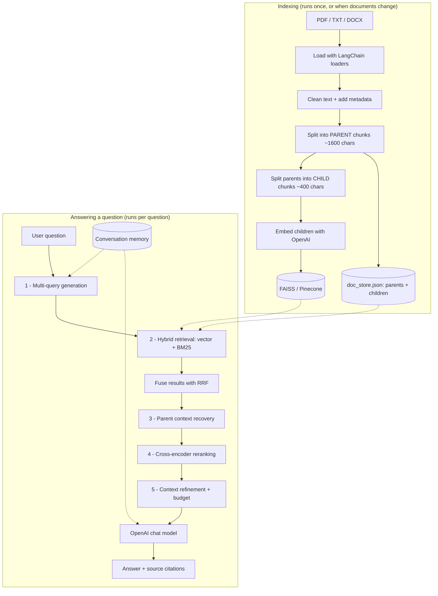

# 📚 Advanced RAG Assistant

An end-to-end **Advanced RAG** (Retrieval-Augmented Generation) application built with
**Python, LangChain, Google Gemini, FAISS, and Streamlit** (with support for Groq and OpenAI).

You give it your documents (PDF, TXT, DOCX), it indexes them, and then you can chat with
them. Every answer comes with source citations, and a **Retrieval Debug Mode** lets you
watch each stage of the pipeline do its job.

This project is configured out of the box to run with **Google Gemini** (free tier via Google AI Studio)
and **local HuggingFace embeddings** (`all-MiniLM-L6-v2`) on CPU, so it is **100% free to run**.

---

## Table of contents

- [Project overview](#project-overview)
- [What is Advanced RAG?](#what-is-advanced-rag)
- [Architecture](#architecture)
- [The five advanced techniques](#the-five-advanced-techniques)
- [Project structure](#project-structure)
- [Installation](#installation)
- [Environment setup (.env)](#environment-setup-env)
- [OpenAI configuration](#openai-configuration)
- [FAISS (default, local)](#faiss-default-local)
- [Pinecone (optional, remote)](#pinecone-optional-remote)
- [Running the application](#running-the-application)
- [Building the index](#building-the-index)
- [Updating the index](#updating-the-index)
- [Using Retrieval Debug Mode](#using-retrieval-debug-mode)
- [Conversation memory](#conversation-memory)
- [Evaluation](#evaluation)
- [Running the tests](#running-the-tests)
- [Troubleshooting](#troubleshooting)
- [Learning outcomes](#learning-outcomes)

---

## Project overview

The app ships with a small synthetic knowledge base for a fictional company called
**TechNova Solutions**:

| File | Format | Contents |
|---|---|---|
| `technova_employee_handbook.pdf` | PDF | Leave, remote work, expenses, reviews |
| `technova_product_guide.pdf` | PDF | The NovaCloud product, pricing, limits |
| `technova_support_policy.txt` | TXT | Support plans, response times, refunds |
| `technova_security_policy.docx` | DOCX | Passwords, MFA, encryption, compliance |

Ask it things like:

- *"How many days of annual leave do employees get?"*
- *"What is TechNova's refund policy?"* → *"Does that policy apply to enterprise customers?"*
- *"What is the minimum password length?"*

You can also upload your own PDF, TXT or DOCX files from the sidebar.

---

## What is Advanced RAG?

**Basic RAG** is three steps:

1. Split your documents into chunks and store them in a vector database.
2. When a question arrives, find the chunks whose embeddings are closest to it.
3. Paste those chunks into a prompt and ask an LLM to answer.

It works, and it breaks in predictable ways:

- The user says *"time off"* but the handbook says *"annual leave"* → the search misses.
- The question contains an exact code like *"SOC 2"*, which embeddings handle poorly.
- The retrieved chunk is too small for the model to answer from.
- The top 5 results by vector distance are not actually the 5 most useful chunks.
- Irrelevant chunks sneak into the prompt and the model invents an answer from them.

**Advanced RAG** is simply the set of fixes for those problems. This project implements
five of the most practical ones, and each one maps directly to a failure above.

---

## Architecture



As plain text:

```text
User Query
    ↓
Multi-Query Generation        (src/retrieval.py)
    ↓
Hybrid Retrieval              (src/retrieval.py)  vector + BM25
    ↓
Candidate Child Documents
    ↓
Parent Context Recovery       (src/retrieval.py)
    ↓
Cross-Encoder Reranking       (src/reranking.py)
    ↓
Context Refinement            (src/refinement.py)
    ↓
Final Context
    ↓
OpenAI LLM                    (src/rag_pipeline.py)
    ↓
Answer + Sources
```

---

## The five advanced techniques

### 1. Hybrid Retrieval  → `src/retrieval.py`

**The problem:** vector search understands *meaning* but is weak on exact strings.
Ask for *"SOC 2"* or *"TN-SUP-2024"* and semantic search can drift to vaguely related
text. Keyword search has the opposite strength and the opposite weakness.

**The fix:** run both, then merge.

- **Vector search** (FAISS/Pinecone) finds chunks that *mean* the same thing.
- **BM25 keyword search** (`rank_bm25`) finds chunks containing the same *words*.

The two ranked lists are merged with **Reciprocal Rank Fusion (RRF)**: each document
scores `1 / (60 + its position)` in every list it appears in, and the scores are summed.
A chunk that both methods like rises to the top. RRF needs no score calibration between
the two systems, which is exactly why it is the standard choice.

### 2. Multi-Query Retrieval  → `src/retrieval.py`

**The problem:** one question is one phrasing, and one phrasing can miss the document.

**The fix:** ask the LLM to rewrite the question a few different ways and search with all
of them.

```text
"What is the refund policy?"
    → "How do refunds work at TechNova?"
    → "money back guarantee terms"
    → "Can I get my money back after cancelling?"
```

As a bonus, the rewriting prompt also receives the conversation history, which is what
turns a vague follow-up (*"does it apply to enterprise customers?"*) into a standalone,
searchable query.

### 3. Parent-Child Retrieval  → `src/chunking.py` + `src/retrieval.py`

**The problem:** chunk size is a trade-off. Small chunks are found accurately but contain
too little to answer from. Large chunks answer well but match imprecisely, because one
embedding has to represent several different ideas.

**The fix:** stop choosing. Use both.

- Documents are split into large **parent** chunks (~1600 characters).
- Each parent is split again into small **child** chunks (~400 characters).
- Only **children are embedded and searched** — that keeps retrieval sharp.
- Each child stores its `parent_id`, so once a child matches we hand the **parent** to
  the LLM — that keeps the context complete.

```text
child "Refunds are issued to the original payment method"   ← matched the search
parent "5. REFUND POLICY  Customers on monthly self-service plans may request a
        full refund within 30 days ... Enterprise contracts are not covered ..."  ← sent to the LLM
```

If two children from the same parent both match, they collapse into one parent, so the
same text is never sent twice.

### 4. Cross-Encoder Reranking  → `src/reranking.py`

**The problem:** retrieval compares the question vector and the chunk vector, which were
created *separately*. That is fast enough to search thousands of chunks, but it is only
an approximation of relevance.

**The fix:** a **cross-encoder** reads the question and the chunk *together* and scores
how well that chunk answers that question. It is much more accurate and much slower — so
we use it in the classic two-stage pattern:

```text
fast retrieval → ~10 candidates → slow accurate reranker → best 4
```

The model (`cross-encoder/ms-marco-MiniLM-L-6-v2`) runs **locally on your CPU** and is
downloaded automatically the first time you ask a question. No API cost. If it cannot be
loaded, the app falls back to a simple keyword reranker — see
[Running without PyTorch at all](#running-without-pytorch-at-all).

Real scores from the sample documents, for the question *"Does the 30 day refund policy
apply to enterprise customers?"*:

```text
 5.14  technova_support_policy.txt - Section: REFUND POLICY
 1.91  technova_support_policy.txt - Section: HOW TO REQUEST A REFUND
-3.61  technova_support_policy.txt - Section: TECHNOVA CUSTOMER SUPPORT POLICY
-8.41  technova_security_policy.docx - Section: Password Policy   ← dropped by refinement
```

### 5. Context Refinement  → `src/refinement.py`

**The problem:** retrieval always returns its top N, even when some of them are junk.
Junk in the prompt makes the model more likely to invent an answer, and long prompts are
slower and more expensive.

**The fix:** three small, readable steps.

1. **Drop irrelevant chunks** — anything the cross-encoder scored below
   `MIN_RERANK_SCORE` (default `-4.0`) is thrown away.
2. **Respect a context budget** — keep adding chunks until `MAX_CONTEXT_CHARS`
   (default 8000, roughly 2000 tokens) is reached. Because the list is already sorted
   best-first, the least useful text is what gets cut.
3. **Format with sources** — each surviving chunk is numbered and labelled, so the prompt
   can ask the model to cite `[1]` and `[2]`.

This is intentionally *not* a full contextual-compression framework. The goal is to make
the idea obvious.

---

## Project structure

```text
advanced-rag-project/
│
├── app.py                 # Streamlit UI (sidebar, chat, debug panel)
├── config.py              # Every setting, read from .env. Start here.
├── llm_client.py          # Creates the OpenAI chat + embedding models, once
├── conftest.py            # Lets pytest import the project modules
├── requirements.txt          # Full install (includes the cross-encoder)
├── requirements-minimal.txt  # Same project, no PyTorch
├── .env.example           # Template for your own .env
│
├── data/
│   ├── documents/         # The TechNova samples + anything you upload
│   └── evaluation/
│       └── questions.json # 20 synthetic evaluation questions
│
├── vectorstore/           # Created when you build the index (git-ignored)
│   ├── faiss/             # The FAISS index files
│   └── doc_store.json     # Parent + child chunks, for BM25 and parent lookup
│
├── src/
│   ├── ingestion.py       # Load PDF/TXT/DOCX, clean text, add metadata
│   ├── chunking.py        # Parent + child chunk creation
│   ├── indexing.py        # Build / update / clear the vector DB
│   ├── retrieval.py       # Multi-query, hybrid search, RRF, parent recovery
│   ├── reranking.py       # Cross-encoder reranking
│   ├── refinement.py      # Filter, budget, format context, build citations
│   ├── memory.py          # Session conversation history
│   └── rag_pipeline.py    # The whole pipeline, in order, in one function
│
├── scripts/
│   ├── build_index.py              # Build the index from the command line
│   ├── update_index.py             # Add new documents to an existing index
│   ├── evaluate.py                 # Run the evaluation questions
│   └── generate_sample_documents.py# Recreate the TechNova PDF/DOCX samples
│
└── tests/
    └── test_pipeline.py   # 22 offline tests (no API key needed)
```

**Where to read first:** `src/rag_pipeline.py` → `answer_question()`. It is a numbered
list of the six pipeline steps, and each step is one call into one module.

---

## Installation

**Prerequisites:** Python 3.10 or newer, and an OpenAI API key.

```bash
# 1. Get the project and move into it
cd advanced-rag-project

# 2. Create a virtual environment
python -m venv .venv

# 3. Activate it
#    Windows (PowerShell):
.venv\Scripts\Activate.ps1
#    macOS / Linux:
source .venv/bin/activate

# 4. Install the dependencies
pip install -r requirements.txt
```

The install takes a few minutes, mostly because `sentence-transformers` pulls in PyTorch
for the reranker.

**If that install fails, or PyTorch will not load on your machine**, use the torch-free
install instead — everything still works:

```bash
pip install -r requirements-minimal.txt
```

then add this line to your `.env`:

```text
RERANKER=simple
```

See [Do I need a GPU?](#do-i-need-a-gpu) for what changes.

### Do I need a GPU?

**No.** A normal CPU-only laptop is all this project needs.

The two heavy models — the chat model and the embedding model — run on OpenAI's servers,
not on your machine. The only model that runs locally is the cross-encoder reranker, and
it is deliberately a small one (6 layers, ~90 MB). On a mid-range CPU-only laptop it
scores 10 passages in well under a tenth of a second.

`faiss-cpu` is, as the name says, the CPU build, and PyTorch installs its CPU build too:

```bash
python -c "import torch; print(torch.__version__, torch.cuda.is_available())"
# 2.13.0+cpu False      ← this is exactly what you want
```

One gotcha if you are on **Linux or WSL**: `pip install torch` from PyPI gives you the
CUDA build (~2.5 GB of NVIDIA libraries) even when the machine has no graphics card. It
still works, it is just a big download. To get the ~500 MB CPU wheel instead, install
torch first:

```bash
pip install torch --index-url https://download.pytorch.org/whl/cpu
pip install -r requirements.txt
```

Windows and macOS install the CPU build by default, so there is nothing to do.

### Running without PyTorch at all

Some machines simply refuse to run PyTorch — very old CPUs, locked-down work laptops, or
a mismatched Anaconda install that produces this classic Windows error:

```text
OSError: [WinError 1114] A dynamic link library (DLL) initialization routine failed.
Error loading "...\torch\lib\c10.dll"
```

You do not need PyTorch to run this project. Install `requirements-minimal.txt` and set
`RERANKER=simple` in your `.env`.

| | Full install | Minimal install |
|---|---|---|
| Reranker | cross-encoder model | keyword overlap |
| Extra download | ~700 MB (PyTorch) | none |
| Everything else | identical | identical |

Only step 5 of the pipeline changes. Ingestion, chunking, FAISS, hybrid retrieval,
multi-query, parent-child recovery, context refinement, citations, memory, the Streamlit
UI and evaluation all behave exactly the same.

The simple reranker scores a chunk by how many of the question's words it contains,
mapped onto the same roughly -5 to +5 scale the cross-encoder uses, so `MIN_RERANK_SCORE`
and the rest of the pipeline keep working untouched. It is noticeably cruder — it matches
words, not meaning — which is a good thing for a learner to *see*: turn the reranker off
and watch the answer quality drop.

You do not have to set `RERANKER=simple` for the app to survive. If the cross-encoder
cannot be loaded for any reason, the app logs one warning, switches to the simple
reranker and carries on. The sidebar always shows which reranker is actually in use.

---

## Environment setup (.env)

Copy the template and fill in your key:

```bash
# Windows (PowerShell)
copy .env.example .env

# macOS / Linux
cp .env.example .env
```

A `.env` file is just a list of `NAME=value` lines. `config.py` reads it at startup with
`python-dotenv`, which is how secrets stay out of your source code. **Never commit
`.env`** — the included `.gitignore` already excludes it.

The only line you must fill in is:

```text
OPENAI_API_KEY=sk-...your key here...
```

---

## OpenAI configuration

| Variable | Default | What it does |
|---|---|---|
| `OPENAI_API_KEY` | *(required)* | Your key from [platform.openai.com](https://platform.openai.com/api-keys) |
| `OPENAI_CHAT_MODEL` | `gpt-4o-mini` | Writes query variants and the final answer |
| `OPENAI_EMBEDDING_MODEL` | `text-embedding-3-small` | Turns chunks into vectors |

Both models are created in one place, `llm_client.py`, and cached with `@lru_cache` so the
app does not build a new client for every question.

> **Important:** if you change the embedding model, you must rebuild the index. Vectors
> from different models are not comparable.

**Cost:** indexing the sample documents costs well under a cent. Each question is one
small rewrite call plus one answer call with ~2000 tokens of context.

Other settings (chunk sizes, how many documents to retrieve, the context budget) are also
in `.env` and documented in `config.py`. They are all safe to leave alone.

---

## FAISS (default, local)

FAISS is Facebook AI Similarity Search, a library for finding the nearest vectors in a
set. It is the default here because it needs **no account, no server and no internet**.

When you build the index:

- Your chunks are sent to OpenAI once, to be embedded.
- The resulting vectors are saved to `vectorstore/faiss/` as two files
  (`index.faiss` and `index.pkl`).
- The chunks themselves are saved to `vectorstore/doc_store.json`, which powers BM25
  keyword search and parent lookup.

Everything after that is local. Reopening the app reloads these files instead of
re-embedding, so you only pay for embeddings once.

---

## Pinecone (optional, remote)

Pinecone is a hosted vector database. Use it if you want the index to live in the cloud
instead of on your laptop. **You do not need it for this project.**

To switch:

1. Create an account at [pinecone.io](https://www.pinecone.io/) and get an API key.
2. In the Pinecone console, create an index with the dimension that matches your
   embedding model — **1536** for `text-embedding-3-small`, **3072** for
   `text-embedding-3-large` — and metric `cosine`.
3. Update your `.env`:

   ```text
   VECTOR_DB=pinecone
   PINECONE_API_KEY=your-key
   PINECONE_INDEX_NAME=advanced-rag
   PINECONE_NAMESPACE=default
   ```

4. Rebuild the index.

You can also flip between FAISS and Pinecone from the sidebar dropdown, which affects the
running app only. Change `.env` to make it permanent and to affect the scripts.

Note that `doc_store.json` stays local even with Pinecone, because BM25 search and parent
lookup read from it.

---

## Running the application

```bash
streamlit run app.py
```

Streamlit opens `http://localhost:8501` in your browser.

First run, in order:

1. Sidebar → **🔨 Build Vector DB** (indexes the four TechNova samples, takes ~20 seconds).
2. Ask a question in the chat box at the bottom.
3. Tick **Show Retrieval Details** and ask another question to watch the pipeline work.

---

## Building the index

From the UI: sidebar → **🔨 Build Vector DB**.

From the command line:

```bash
python scripts/build_index.py
```

Either way the same thing happens:

```text
data/documents/*  →  load + clean  →  parent chunks  →  child chunks
                  →  embed children  →  FAISS  +  doc_store.json
```

Building **replaces** any existing index. Use it the first time, after changing the
embedding model or chunk sizes, or whenever you want a clean slate.

To start completely fresh, use **🗑️ Clear / Rebuild** in the sidebar, which deletes the
FAISS folder and the document store.

---

## Updating the index

When you add one new document, you do not want to re-embed everything you already paid
for. That is what **update** is for.

From the UI:

1. Sidebar → **Upload documents** → choose your PDF/TXT/DOCX files.
2. Click **Save uploaded files** (they are copied into `data/documents/`).
3. Click **➕ Update Vector DB**.

From the command line:

```bash
python scripts/update_index.py
```

Only chunks that are not already in the index are embedded and added. Chunk ids are built
from the filename, so re-running the update adds nothing the second time and you cannot
accidentally create duplicate search results.

---

## Using Retrieval Debug Mode

Tick **Show Retrieval Details** in the sidebar, then ask a question and expand
**🔍 Retrieval details** under the answer. You will see:

| Section | What to look for |
|---|---|
| **1. Original query** | What you typed |
| **2. Generated queries** | The LLM's alternative phrasings — multi-query retrieval |
| **3. Retrieved candidates** | ~10 small child chunks after hybrid search + RRF |
| **4. After reranking** | The same chunks as parents, reordered, with scores |
| **5. Final context** | What actually went into the prompt, after filtering and budgeting |
| **Sources** | The citations shown with the answer |

Things worth noticing as a learner:

- A chunk that was 7th after retrieval can be 1st after reranking. That gap is exactly
  why rerankers exist.
- The text in step 4 is **longer** than in step 3 — that is parent recovery.
- Low-scoring chunks visible in step 4 disappear in step 5 — that is refinement.
- Ask a question your documents cannot answer and watch every score go negative.

---

## Conversation memory

Memory is LangChain's `InMemoryChatMessageHistory`: a list of messages kept in the
Streamlit session. No database, no files. Closing the tab clears it.

It is used twice:

1. When rewriting the question, so follow-ups resolve to something searchable.
2. In the answer prompt, so the reply reads like part of a conversation.

Try it:

```text
You: What is TechNova's refund policy?
You: Does that policy apply to enterprise customers?
```

Only the last `MEMORY_WINDOW` exchanges (default 4) are sent, which keeps prompts small.
**Clear conversation** in the sidebar empties it.

---

## Evaluation

`data/evaluation/questions.json` contains 20 synthetic questions about the TechNova
documents. Each one lists the file that contains the answer and a few keywords a correct
answer should mention.

```bash
python scripts/evaluate.py              # all 20 questions
python scripts/evaluate.py --limit 5    # quick check
```

For every question the script checks two things:

- **Retrieval:** was the correct document cited?
- **Answer:** does the answer contain at least one expected keyword?

```text
============================================================
SUMMARY
  Correct source cited  : 19/20 (95%)
  Expected keyword found: 18/20 (90%)
  Both correct          : 18/20 (90%)
============================================================
```

Full results are written to `data/evaluation/results.json`.

This is a keyword check, not a judge model — deliberately. It is free, instant and easy
to read, and it will catch the moment you break retrieval. The point is to show that a
RAG system should be measured at all; stronger evaluation (LLM-as-judge, RAGAS) is the
natural next step.

---

## Running the tests

```bash
pytest
```

22 tests, all offline — they never call OpenAI, so they are free and instant. They cover
document cleaning, metadata, parent/child chunking, RRF fusion, parent recovery, context
refinement and citation formatting.

---

## Troubleshooting

**`OPENAI_API_KEY is not set`**
You have no `.env`, or the key line is empty. Copy `.env.example` to `.env`, paste your
key, and restart the app (Streamlit reads `.env` only at startup).

**`No FAISS index found`**
Click **🔨 Build Vector DB** in the sidebar, or run `python scripts/build_index.py`.

**`OSError: [WinError 1114] ... c10.dll` or any other PyTorch/DLL error**
PyTorch cannot load on that machine. Fastest fix: `pip uninstall -y sentence-transformers`,
install `requirements-minimal.txt`, and set `RERANKER=simple` in `.env`. If you would
rather keep the cross-encoder, the usual causes are a missing
[Visual C++ Redistributable](https://aka.ms/vs/17/release/vc_redist.x64.exe), or a venv
created from Anaconda whose DLLs clash with the pip-installed torch — rebuild the venv
with a python.org interpreter, or install torch from
`https://download.pytorch.org/whl/cpu`.

**The sidebar says "simple keyword (cross-encoder failed: ...)"**
That is the fallback doing its job: the app kept running instead of crashing. The message
after "failed:" tells you why. Answers will be a little worse until you fix the install.

**The first question takes 30+ seconds**
The cross-encoder (~90 MB) is downloading from Hugging Face on first use. It is cached
afterwards and later questions take a couple of seconds.

**`RateLimitError` or `insufficient_quota`**
Your OpenAI account has no credit. Add billing at platform.openai.com. A free-tier key
without credit cannot call the API.

**Answers say the information is not in the documents, but you know it is**
Turn on **Show Retrieval Details**. If the right chunk never appears in step 3, the
retrieval is the problem — try raising `VECTOR_TOP_K` / `HYBRID_TOP_K`. If it appears in
step 3 but vanishes by step 5, refinement is too strict — lower `MIN_RERANK_SCORE`
(more negative) or raise `RERANK_TOP_K`.

**`ModuleNotFoundError: No module named 'src'`**
Run commands from the project root folder, not from inside `src/` or `scripts/`.

**A `DeprecationWarning` about `langchain-community`**
Harmless. The FAISS store, the document loaders and BM25 still live in that package.

**Changed the embedding model and now results are nonsense**
Rebuild the index. Vectors from two different models cannot be compared.

**You edited a document and the update did nothing**
Chunk ids come from the filename, so an update treats an edited file as "already
indexed". Do a full rebuild after editing a document, or save it under a new name.

**A scanned PDF returns nothing**
The loaders read a PDF's text layer. A scanned image has none, and OCR is out of scope
here.

---

## Learning outcomes

After building and explaining this project you can confidently say you have:

- Built a **complete RAG pipeline** from document ingestion to a cited answer.
- Used **LangChain** for loaders, text splitters, prompt templates, embeddings, chat
  models, retrievers and conversation memory.
- Implemented **parent-child chunking** and explained the precision/context trade-off it
  resolves.
- Implemented **hybrid retrieval** and fused the rankings with **Reciprocal Rank Fusion**.
- Used an LLM for **multi-query generation**, including history-aware follow-up rewriting.
- Applied **two-stage retrieval** with a local **cross-encoder reranker**, and can explain
  why a bi-encoder is fast and a cross-encoder is accurate.
- Controlled prompt quality and cost with **context refinement and a context budget**.
- Produced **source citations** from document metadata (file, page, section).
- Worked with both a **local vector database (FAISS)** and a **remote one (Pinecone)**
  behind the same code.
- Built a usable **Streamlit** interface, including an educational debug view.
- Written a **basic evaluation harness** and offline **unit tests** for a GenAI system.

Good interview questions to be ready for: *Why embed child chunks but send parents? Why is
BM25 still useful when you have embeddings? Why rerank when retrieval already ranked the
results? What happens if you skip context refinement?* Every one of them is answered by a
file in `src/`.
